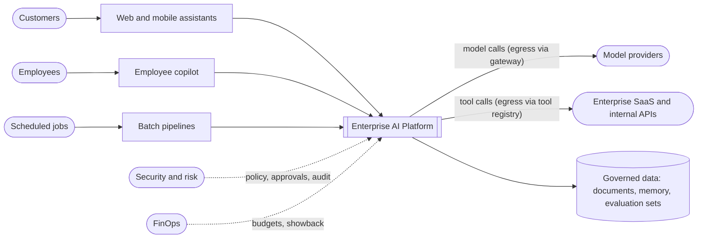

# AI platform reference architecture

[](https://github.com/darshansatpathy/ai-platform-reference-architecture/actions/workflows/ci.yml)
[](https://github.com/darshansatpathy/ai-platform-reference-architecture/actions/workflows/codeql.yml)
[](LICENSE)

A reference architecture for a governed, multi-model enterprise AI platform, written down as **data**
and checked by **architecture fitness functions** instead of being left in a slide deck.

The design is 27 components in 6 layers: who owns each, how critical it is, what it depends on, what
data it may touch, and what availability it promises. Diagrams, SLO tables, data-flow maps, ownership
registers and runbooks are generated from that data. A command-line tool, `archfit`, fails the build
when the design contradicts itself, for example when a service promises more availability than the
services it calls allow, when restricted data can reach a component that is not cleared for it, or
when anything other than the two designated egress components can call the outside world.



## Why this exists

Architecture documents drift. A diagram says one thing, the service catalog another, and the on-call
rota a third. Here the catalog is the single source of truth and the rest is derived from it, so the
documents cannot quietly disagree and the rules that matter are executable.

## Quick start

```bash
python -m venv .venv && source .venv/bin/activate
pip install -e ".[dev]"

archfit check             # run the fitness functions against catalog/platform.toml
archfit docs --check      # fail if docs/generated is out of date
archfit docs              # regenerate docs/generated
archfit cost              # print the unit-economics model
archfit rules             # list the fitness functions
make check                # ruff, mypy --strict, pytest with an 85% coverage gate
```

`archfit` has no runtime dependencies and needs Python 3.11 or newer.

A clean run:

```text
27 components, 13 rules: 0 findings, 0 waived
```

The same design with `ai-gateway` raised to 99.99% availability (a real run on a modified copy of the catalog):

```text
HIGH     FIT005 ai-gateway: declares 99.99% but its hard dependencies allow at most 99.9375%
27 components, 13 rules: 1 findings, 0 waived
```

The command exits non-zero, so CI blocks the change. `--format markdown` produces a table for a pull
request or a job summary, and `--fail-on` sets the severity at which the build fails.

## The fitness functions

There are 14 fitness functions (`FIT000` to `FIT013`), described in full in
[docs/generated/fitness-functions.md](docs/generated/fitness-functions.md).

| Rule | Severity | What it enforces |
|---|---|---|
| FIT001 | critical | The catalog matches its schema |
| FIT002 | critical | Every reference (dependency, owner, ADR, runbook, data class) resolves |
| FIT003 | high | Dependencies respect the layering |
| FIT004 | high | No cycles among synchronous or in-process dependencies |
| FIT005 | high | A component does not promise more availability than its hard dependencies allow |
| FIT006 | critical | Data only flows to components cleared for its classification |
| FIT007 | critical | Only designated egress components call external systems |
| FIT008 | high | A critical component does not hard-depend on a less critical one |
| FIT009 | high | Tier 1 and 2 components have recovery objectives and a runbook |
| FIT010 | high | Tier 1 components have an owner reachable around the clock |
| FIT011 | medium | Tier 1 and 2 components emit traces, metrics and logs |
| FIT012 | low | Every component is used or is an entry point |
| FIT013 | low | Every component has a unique, well-formed cost tag |
| FIT000 | high | A waiver is not past its expiry date |

The check summary counts the rules that ran on the catalog (13); `FIT000` is evaluated only
against waivers, and none are shipped.

Exceptions are explicit. A waiver names the rule, the component, a reason and an expiry date, shows up
in every report, and turns into a finding when it expires. A rule is never switched off quietly.

## What is in the repository

| Path | Contents |
|---|---|
| [`catalog/platform.toml`](catalog/platform.toml) | The architecture as data: layers, teams, data classes, components, dependencies, policy thresholds |
| [`src/archfit`](src/archfit) | The checker and generators |
| [`docs/architecture.md`](docs/architecture.md) | Principles, context, containers, an end-to-end request |
| [`docs/quality-attributes.md`](docs/quality-attributes.md) | Availability, security, cost, operability and evaluation targets |
| [`docs/operating-model.md`](docs/operating-model.md) | Teams, decision rights, change flow, on-call |
| [`docs/adoption-roadmap.md`](docs/adoption-roadmap.md) | A staged path from pilot to scale |
| [`docs/risk-register.md`](docs/risk-register.md) | Ten or more risks, each with mitigations, an early indicator and an owner |
| [`docs/adr/`](docs/adr) | Nine architecture decision records |
| [`docs/runbooks/`](docs/runbooks) | One runbook per operated component |
| [`docs/generated/`](docs/generated) | Components, dependency graph, data flows, SLO register, ownership, fitness functions, unit economics |
| [`finops/scenarios.toml`](finops/scenarios.toml) | Inputs for the unit-economics model (placeholders) |

## Decisions

1. [Private and keyless by default](docs/adr/0001-private-by-default-network-and-identity.md)
2. [A governed agent runtime](docs/adr/0002-governed-agent-runtime.md)
3. [Approval and policy at the tool boundary](docs/adr/0003-approval-and-policy-at-the-tool-boundary.md)
4. [One gateway, many model providers](docs/adr/0004-single-gateway-multi-provider.md)
5. [Config as code, gated by evaluation](docs/adr/0005-config-as-code-with-evaluation-gates.md)
6. [Classification-driven data platform](docs/adr/0006-classification-driven-data-platform.md)
7. [Asynchronous work for non-interactive use cases](docs/adr/0007-asynchronous-work-for-non-interactive-use-cases.md)
8. [OpenTelemetry with redaction at the collector](docs/adr/0008-open-telemetry-with-redaction-at-the-collector.md)
9. [FinOps allocation by component](docs/adr/0009-finops-allocation-by-component.md)

## Related repositories

Components in the catalog link to a reference implementation where one exists. The ones built to the
same standard as this repository:

- [`azure-ai-landing-zone`](https://github.com/darshansatpathy/azure-ai-landing-zone): private, keyless Azure foundation with policy-as-code
- [`claude-agent-reference`](https://github.com/darshansatpathy/claude-agent-reference): budgeted, audited agent runtime on the Claude API
- [`agent-guardrails-gateway`](https://github.com/darshansatpathy/agent-guardrails-gateway), [`agent-eval-harness`](https://github.com/darshansatpathy/agent-eval-harness), [`agent-tracing-otel`](https://github.com/darshansatpathy/agent-tracing-otel), [`agent-memory-service`](https://github.com/darshansatpathy/agent-memory-service), [`human-in-the-loop-inbox`](https://github.com/darshansatpathy/human-in-the-loop-inbox)

## What has and has not been verified

**Verified by the test suite and CI**

- Every fitness function has a failing-case test built by mutating the shipped catalog, and a test asserts that no rule ID goes unexercised.
- The shipped catalog passes all rules with no waivers.
- Generated documents match the catalog (`archfit docs --check`).
- Markdown links resolve; ADRs are numbered, complete and each governs at least one component; every operated component has a complete runbook; risks reference real components, ADRs and owner teams.
- The unit-economics arithmetic is checked against hand calculations.
- Code is linted, formatted, type-checked in strict mode, tested on Python 3.11 to 3.13 with an 85% coverage gate, built as a wheel and run from a clean environment, scanned by CodeQL and audited with `pip-audit`.

**Not verified, and not claimed**

- **The numbers are design targets and placeholders.** Availability, RTO and RPO figures in the catalog are targets for a reference design. Prices and volumes in `finops/` are illustrative. Replace them with measured and contracted values before using either to make a decision.
- **No component is deployed.** The architecture is internally consistent; that does not show it performs, scales or costs what the model says.
- **The rules check consistency, not quality.** A design that passes can still be a poor design. The rules encode the principles in [docs/architecture.md](docs/architecture.md); they are not a substitute for review.
- **The availability ceiling is a simplification.** It treats synchronous hard dependencies as independent and multiplies them, with a fallback formula for redundant paths. Real failures are correlated.
- The runbooks are templates grounded in the catalog. They have not been exercised in an incident.
- Mermaid diagrams are rendered by GitHub; they were not rendered during development.

## Contributing and security

See [CONTRIBUTING.md](CONTRIBUTING.md) and [SECURITY.md](SECURITY.md). This repository contains no
credentials, customer data or real prices, and should not.

## Licence

MIT. See [LICENSE](LICENSE).
