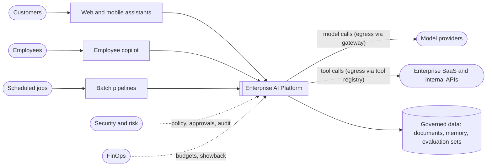

# Architecture

This is the reference design for a governed, multi-model AI platform. The design is **data**:
the components, their dependencies, the data they carry, who owns them and what they promise
are in [`catalog/platform.toml`](../catalog/platform.toml). Diagrams and tables under
[`generated/`](generated) are rendered from it, and [fitness functions](generated/fitness-functions.md)
fail the build when the design contradicts its own rules.

## Principles

1. **One way in, one way out.** All model traffic passes through one gateway; only two
   components may call external systems ([ADR 0004](adr/0004-single-gateway-multi-provider.md)).
2. **Private and keyless by default** ([ADR 0001](adr/0001-private-by-default-network-and-identity.md)).
3. **Control at the boundary, not in the prompt** ([ADR 0003](adr/0003-approval-and-policy-at-the-tool-boundary.md)).
4. **Behaviour is config, and config is code.** Prompts, routing and policy are versioned and
   gated by evaluation ([ADR 0005](adr/0005-config-as-code-with-evaluation-gates.md)).
5. **Data classification is enforced, not advisory** ([ADR 0006](adr/0006-classification-driven-data-platform.md)).
6. **Every promise is checkable.** An availability target above what dependencies allow, a
   critical service resting on a minor one, or an unowned component fails the build.

## Context

## Containers

The full container view is generated: [dependencies](generated/dependencies.md) shows every
component grouped by layer, and the critical path each channel needs to be up.

| Layer | Components | Responsibility |
|---|---|---|
| Channels | web-assistant, internal-copilot, batch-pipelines | Where people and jobs meet the platform |
| Agents | agent-runtime, workflow-orchestrator | Run tool-using agents and durable workflows within hard limits |
| AI platform | ai-gateway, model-router, guardrails-service, prompt-registry, tool-registry, memory-service, eval-service, human-review-inbox, private-model-endpoint, cicd-pipeline | Shared services every product uses |
| Data | vector-store, ingestion-pipeline, lakehouse, data-catalog | Governed knowledge and evaluation data |
| Foundation | identity-provider, secrets-manager, network-fabric, observability-stack, cost-management | Identity, secrets, connectivity, telemetry, cost |
| External | primary and secondary model providers, enterprise SaaS APIs | Systems outside the trust boundary |

Layer dependencies are one-directional (channels above agents above platform above data above
foundation), enforced by `FIT003`.

## A request, end to end

1. A user message reaches `web-assistant`, which authenticates the user with `identity-provider`.
2. `agent-runtime` starts a run with a budget and calls `ai-gateway` for each model turn.
3. The gateway validates the caller, applies its token budget, asks `guardrails-service` to
   screen the input, routes with `model-router`, and calls the primary provider (or the
   secondary on failure). Restricted-class requests go to `private-model-endpoint` instead.
4. If the model asks for a tool, `agent-runtime` validates the call against `tool-registry`.
   Writes wait for a person in `human-review-inbox`.
5. Every step emits traces, metrics and logs to `observability-stack`, redacted at the
   collector, and cost is attributed to the component and caller.

## What this reference does not decide

- **Cloud and product choices.** Components are roles, not vendors. The linked repositories
  show one implementation of several; the Azure landing zone is one concrete foundation.
- **Your numbers.** Availability, recovery and cost figures are design targets and placeholders
  that make the checks meaningful. Replace them with your own.
- **Organisation design.** Team names are placeholders; the [operating model](operating-model.md)
  shows the responsibilities, not the org chart.
