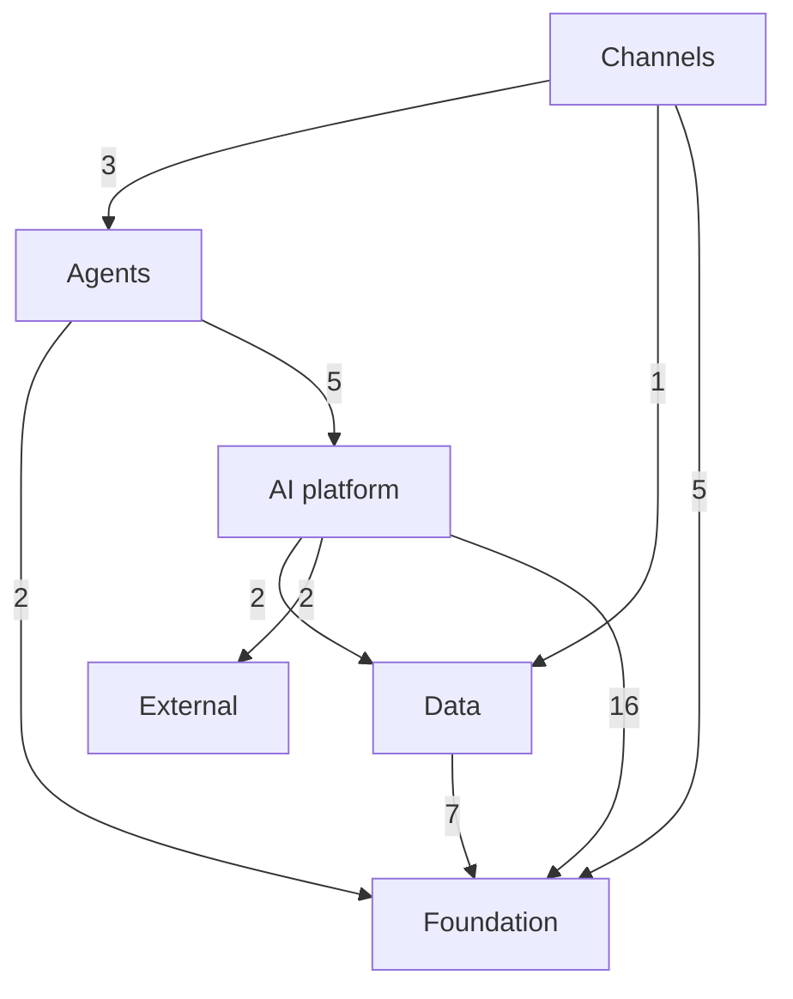
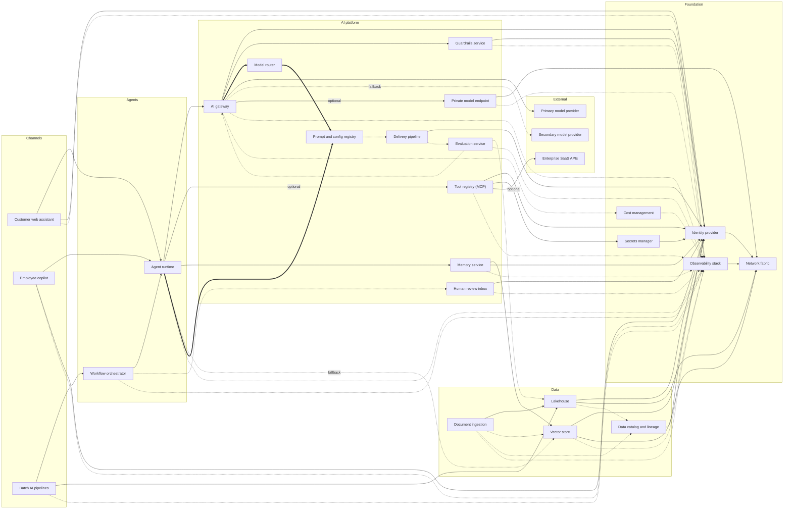
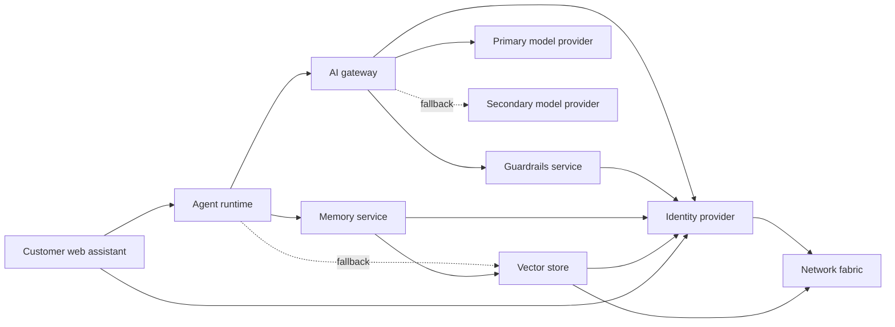
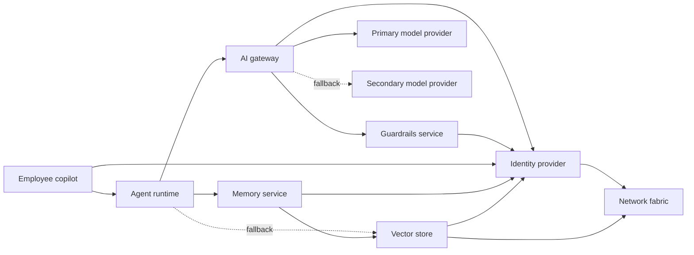
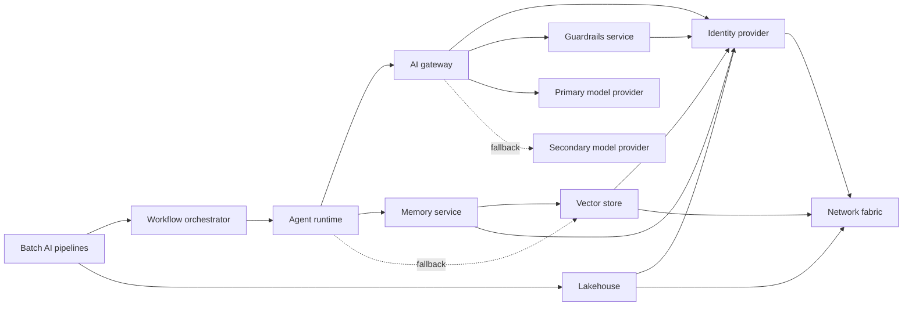

<!-- Generated by `archfit docs` from catalog/platform.toml. Do not edit by hand. -->

# Dependencies

## By layer

Each arrow is the number of dependencies from one layer to another.

## All components

Solid arrow: synchronous call. Dotted: asynchronous. Thick: in-process library. `optional`: the request succeeds without it. `fallback`: used when the primary is down.

## Critical path of `web-assistant`

Everything a request needs to be up, 10 components:

## Critical path of `internal-copilot`

Everything a request needs to be up, 10 components:

## Critical path of `batch-pipelines`

Everything a request needs to be up, 12 components:

